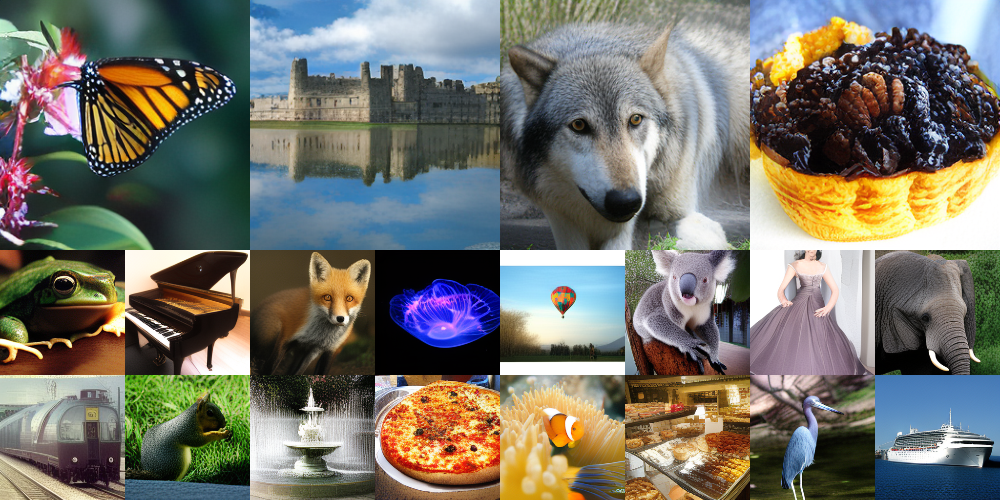

# Empirical Variational Autoencder

<p align="center">
  <a href="https://arxiv.org/abs/2610.06545"></a>
  <a href="https://mapooon.github.io/EVAPage/"></a>
  <a href="https://huggingface.co/mapooon/models"></a>
</p>

<p align="center">
  
</p>

Official PyTorch implementation of EVA.
```bibtex
@article{shiohara2026empirical,
  title={Empirical Variational Autoencoder},
  author={Kaede Shiohara},
  journal={arXiv:2610.06545},
  year={2026}
}
```

This repository contains:

* The [EVA implementation](models/eva.py) for image and audio latents.
* Distributed training, generation, and reconstruction through separate entry points.
* ImageNet and VGGSound latent caching through [main_cache.py](main_cache.py).
* Reproducible YAML experiment configurations under [configs](configs).
* ImageNet FID/IS/rFID and VGGSound VGGish-FID/IS/rFID evaluation.

Training always uses cached tokenizer posterior moments. Tokenizers are not loaded during
training.

## Model Variants

The architecture is selected only by `model.size`. Individual width, depth, and head-count
overrides are intentionally unsupported.

| Size | Width | Encoder depth | Decoder depth | Heads |
|---|---:|---:|---:|---:|
| EVA-Small | 512 | 8 | 8 | 8 |
| EVA-Base | 768 | 12 | 12 | 12 |
| EVA-Large | 1024 | 16 | 16 | 16 |
| EVA-Huge | 1280 | 20 | 20 | 16 |

All variants use four register tokens, RoPE, full encoder attention, a causal decoder,
per-dimension prior variance, and L2 reconstruction loss. `model.reparam_dim` is the only
independently configurable architecture value.

The training objective is

```text
L = L_reconstruction + KL(q(z_t | x, y) || p(z_t | z_<t, y)).
```

There is no KL term against a fixed standard normal distribution. Posterior and prior
log-variances are clamped to `[-10, 10]`.


## Installation

Create the environment with:

```bash
conda env create -f environment.yaml
conda activate eva
```

The public environment is based on the recorded MAR training environment: Python 3.11,
PyTorch 2.5.1 with CUDA 12.1, torchvision/torchaudio 0.20.1/2.5.1, and diffusers
0.35.1. It adds SoundFile for robust WAV input and output.

VGGSound uses the Stable Audio Open VAE from Hugging Face. Accept its model license and set
`HF_TOKEN` when authentication is required:

```bash
export HF_TOKEN=...
```

## Configuration

Every entry point accepts only a YAML config:

```bash
python main_eva.py --config configs/imagenet/base.yaml
```

Configs support recursive inheritance through `defaults`. The resolved config is written to
`OUTPUT_DIR/config_resolved.yaml`. Unknown fields are rejected instead of being silently
ignored.

Example:

```yaml
defaults:
  - ../default.yaml
  - task.yaml

run:
  mode: train

model:
  size: base
  reparam_dim: 128

paths:
  cached_path: data/imagenet/latents/train
  output_dir: outputs/imagenet/eva_base_d128
```

## Preparation

### ImageNet

Place ImageNet in the standard class-folder layout:

```text
data/imagenet/train/<class_name>/*.JPEG
```

Set `paths.tokenizer_path` in `configs/imagenet/task.yaml` to the pretrained KL16 VAE, then
cache posterior moments:

```bash
torchrun --nproc_per_node=8 main_cache.py \
  --config configs/imagenet/cache.yaml
```

The cache stores moments for both the center-cropped image and its horizontal flip.

### VGGSound

Arrange WAV files by split and class:

```text
data/vggsound/wav/train/<class_id>/*.wav
```

Cache Stable Audio Open VAE posterior moments with:

```bash
torchrun --nproc_per_node=8 main_cache.py \
  --config configs/vggsound/cache.yaml
```

Audio is resampled and converted to the channel count specified by the cache config.
The 309-class model-index mapping is stored in
[`assets/vggsound_class_mapping.json`](assets/vggsound_class_mapping.json). It follows the
sorted training-cache directory order and excludes the absent raw class ID `082`
(`extending ladders`). Generated audio directories use the original VGGSound class IDs.

## Training

Train EVA-Base on ImageNet:

```bash
torchrun --nproc_per_node=8 --nnodes=1 main_eva.py \
  --config configs/imagenet/base.yaml
```

The released EVA-Small architecture is available through `configs/imagenet/small.yaml`.
EVA-Small always means the ImageNet definition (width 512, depth 8), including when it is
used for VGGSound. 

Train EVA-Base on VGGSound:

```bash
torchrun --nproc_per_node=8 --nnodes=1 main_eva.py \
  --config configs/vggsound/base.yaml
```

Set `paths.resume` in the YAML to resume a training checkpoint. Model size, task, and
reparameterization dimension must match the checkpoint.

## Generation and Evaluation

Released inference checkpoints use Safetensors and are loaded strictly. Set
`paths.checkpoint` in the generation config before running. Generation is distributed over
all ranks and only writes samples plus a `manifest.json` containing the model identity,
checkpoint hash, sampling settings, world size, completion state, and final sample count.

ImageNet:

```bash
torchrun --nproc_per_node=8 --nnodes=1 main_generate.py \
  --config configs/imagenet/base_generate.yaml
python main_evaluate.py --config configs/imagenet/base_eval.yaml
```

VGGSound:

```bash
torchrun --nproc_per_node=8 --nnodes=1 main_generate.py \
  --config configs/vggsound/base_generate.yaml
python main_evaluate.py --config configs/vggsound/base_eval.yaml
```

`main_evaluate.py` reads existing samples and is intentionally single-process; do not launch
it with `torchrun`. This keeps all GPUs useful during generation instead of leaving nonzero
ranks waiting while rank 0 computes metrics. It validates the generation manifest when one
is present and writes `metrics.json`.

ImageNet evaluation reports FID and Inception Score using `torch-fidelity`. VGGSound
evaluation reports VGGish-FID and, when `paths.is_model_path` is provided, Inception Score
using the VGGSound classifier.

### Reconstruction FID (rFID)

Reconstruction is also multi-GPU and metric computation is a separate single-process step.
For ImageNet, `paths.data_path` points directly to the evaluation image root (the MAR layout
uses `data/imagenet/test`). The command saves both center-cropped targets and reconstructions,
and rFID compares those two folders:

```bash
torchrun --nproc_per_node=8 --nnodes=1 main_reconstruct.py \
  --config configs/imagenet/base_reconstruct.yaml
python main_evaluate.py --config configs/imagenet/base_rfid.yaml
```

For VGGSound, reconstruction starts from cached test posterior moments. Following the
original VGGSound evaluation, rFID is VGGish FID between reconstructed audio and the test-set
reference statistics:

```bash
torchrun --nproc_per_node=8 --nnodes=1 main_reconstruct.py \
  --config configs/vggsound/base_reconstruct.yaml
python main_evaluate.py --config configs/vggsound/base_rfid.yaml
```

`reconstruction.num_samples: null` means all available cached samples. Reconstruction uses
the unconditional EVA embedding, matching the original rFID procedure. Generated audio and
reconstructed audio are written under original VGGSound class IDs.

## Checkpoint Format

Each released model is accompanied by its resolved config and checksum:

```text
eva_imagenet_base_d128/
├── model.safetensors
├── config.yaml
├── metadata.json
└── SHA256SUMS
```

EMA weights are used for released inference checkpoints.
VGGSound artifacts additionally contain `class_mapping.json`. `metadata.json` records the
tokenizer source, subfolder/revision where applicable, latent scale, source checkpoint
epoch and hashes. The ImageNet tokenizer entry identifies the MAR KL-16 VAE and its
SHA-256; the VGGSound entry identifies `stabilityai/stable-audio-open-1.0`/`vae`.

## Acknowledgements

This implementation builds on the repository structure and training utilities of
[MAR](https://github.com/LTH14/mar). The ImageNet tokenizer implementation is derived from
the KL-VAE in [Latent Diffusion](https://github.com/CompVis/latent-diffusion). VGGSound uses
the VAE released with [Stable Audio Open](https://huggingface.co/stabilityai/stable-audio-open-1.0).
